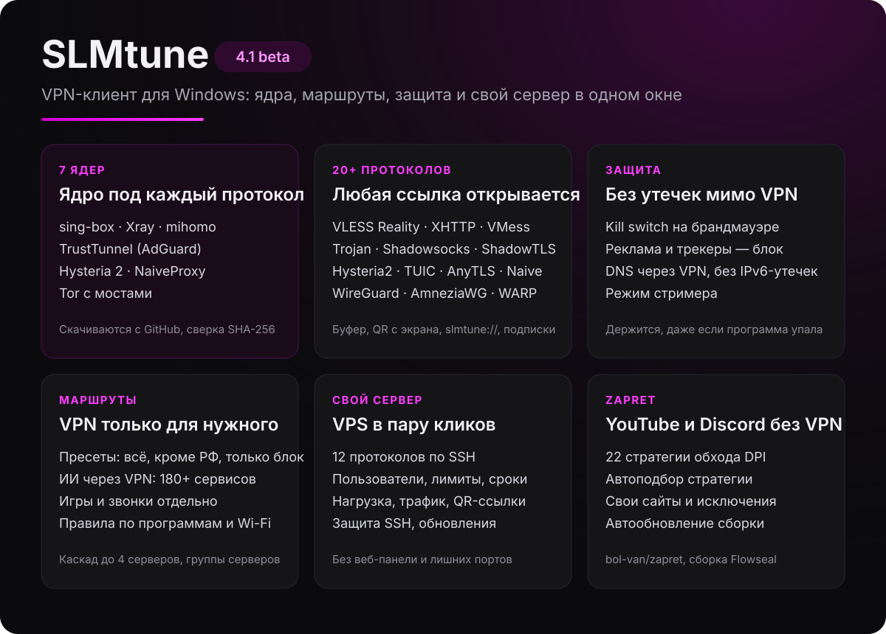
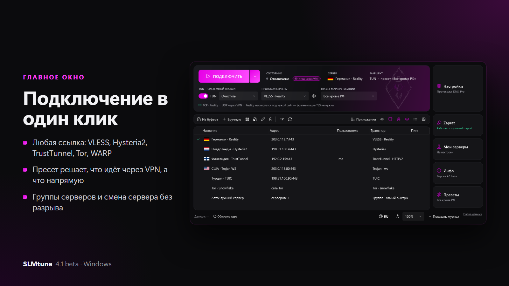
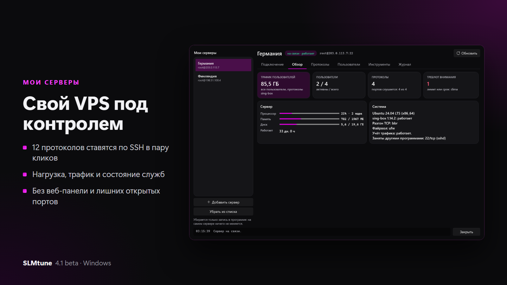
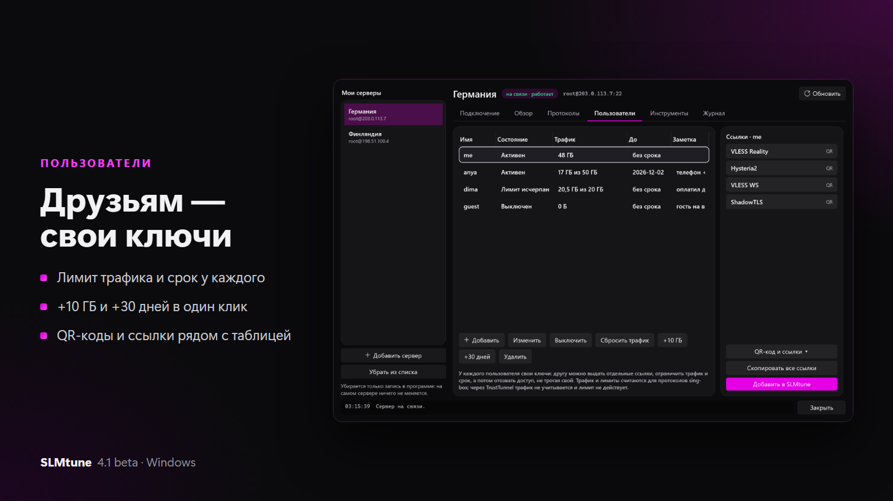
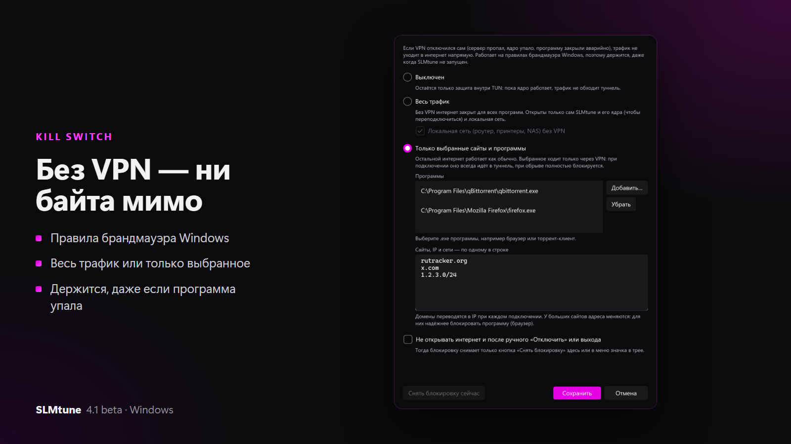
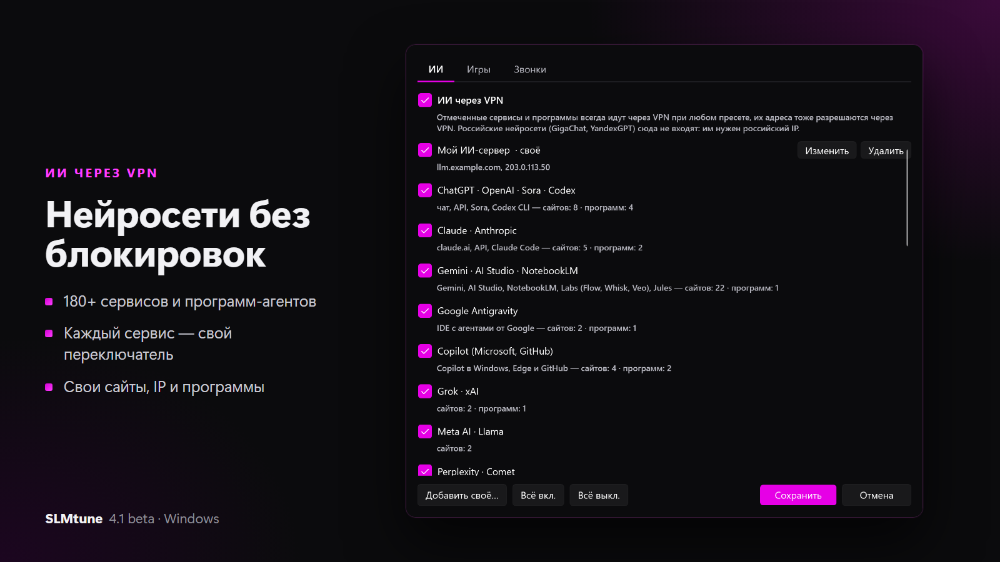
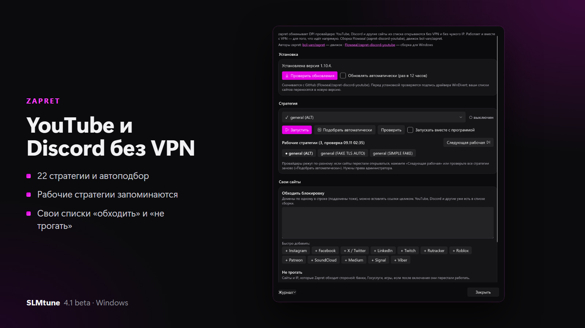
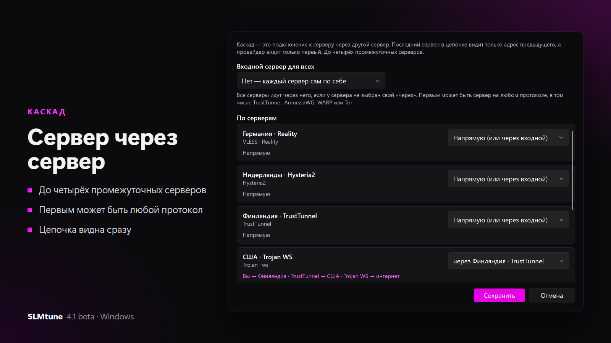
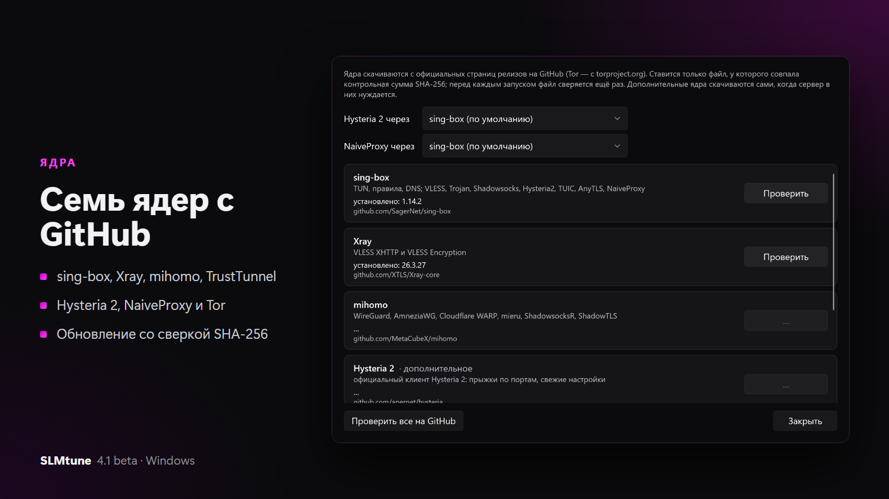
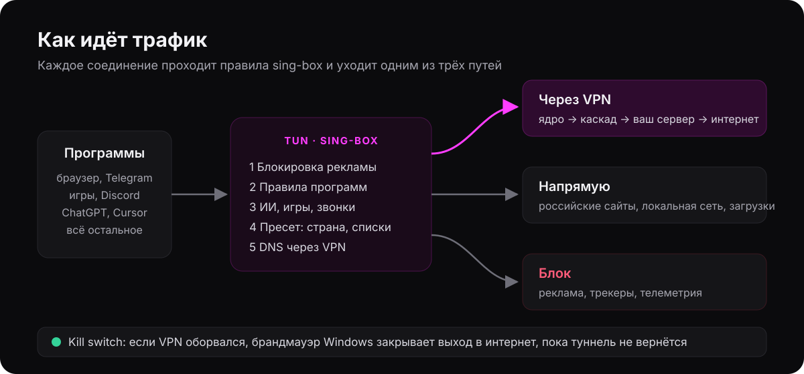

  

  <a href="../../releases/latest"><b>Скачать для Windows</b></a> ·
  <a href="https://github.com/SLM322/slmtune-android">Android</a> ·
  <a href="https://github.com/SLM322/slmtune-ios">iOS</a> ·
  <a href="https://t.me/SLMtune">Telegram-канал</a> ·
  <a href="https://www.donationalerts.com/r/slm322"><b>Поддержать проект</b></a>

**SLMtune** — VPN-клиент для Windows. Он открывает почти любую ссылку на сервер и сам решает, что пустить через VPN, а что напрямую: российские сайты и загрузки идут без VPN, заблокированное и нейросети идут через него, реклама блокируется. Всё в одном окне, без ручной правки конфигов.

Работает на Windows 10 и 11 (x64). Установщик сам удаляет старую версию, настройки и серверы сохраняются. Дальше программа обновляется сама из этого репозитория.

## Скриншоты

<table>
  <tr>
    <td width="50%"></td>
    <td width="50%"></td>
  </tr>
  <tr>
    <td></td>
    <td></td>
  </tr>
  <tr>
    <td></td>
    <td></td>
  </tr>
  <tr>
    <td colspan="2"></td>
  </tr>
</table>

Скриншоты сделаны на демо-данных: серверы, адреса и пользователи выдуманы.

  

## Полный функционал

### Серверы и протоколы
| Что | Подробно |
|---|---|
| **Протоколы** | VLESS (Reality, Vision, WebSocket, gRPC, HTTPUpgrade, XHTTP, VLESS Encryption), VMess, Trojan, Shadowsocks и Shadowsocks 2022, ShadowTLS v3, Hysteria и Hysteria2 (с прыжками по портам), TUIC v5, AnyTLS, NaiveProxy, WireGuard, AmneziaWG 1.0 и 2.0, mieru, ShadowsocksR, SOCKS5, SSH, TrustTunnel |
| **Ядра** | sing-box, Xray, mihomo, TrustTunnel (AdGuard), официальные Hysteria 2 и NaiveProxy, Tor с мостами snowflake, obfs4, meek и WebTunnel. Подходящее ядро выбирается само |
| **Окно «Ядра»** | Версия каждого ядра, установка и обновление с GitHub по одному. Ставится только файл, у которого совпала SHA-256; перед каждым запуском файл сверяется ещё раз |
| **Импорт** | Ctrl+V из буфера, QR-код с экрана, ссылки `slmtune://` из браузера и Telegram, файлы `.conf` и `.toml`, ручной ввод |
| **Подписки** | Автообновление; остаток трафика и срок из заголовка провайдера; предупреждение за 3 дня до конца и при 90 % трафика; повтор через VPN, если сайт подписки заблокирован |
| **Бесплатные каналы** | Cloudflare WARP в один клик (в том числе с маскировкой AmneziaWG) и Tor, когда всё остальное заблокировано |
| **Группы серверов** | «Самый быстрый» (проверяет задержку и переключается сам), «Резерв» (первый работающий по порядку), «Балансировка» (соединения поровну) |
| **Каскад** | Сервер через сервер, до четырёх промежуточных. Входной сервер для всех или свой у каждого. Первым может быть любой протокол |
| **Автоподбор** | Перебирает варианты подключения сервера (sing-box, HTTP/2, HTTP/3), проверяет, что трафик реально идёт, и запоминает рабочий |
| **Без разрыва** | Смена сервера и транспорта не отключает TUN; при сбое — переключение на запасной сервер |

### Маршрутизация
| Что | Подробно |
|---|---|
| **Режимы** | TUN (весь компьютер) или системный прокси (включить, очистить, не менять, PAC). Без TUN — только программы, которые используют прокси |
| **Пресеты** | «Все сайты», «Все кроме страны» (Россия, Украина, Беларусь, Казахстан, Узбекистан, Туркменистан, Иран, Китай, Турция), «Только заблокированное», свой список. Пресетом можно поделиться кодом `ttn-preset:` |
| **ИИ через VPN** | 180+ сервисов и программ всегда идут через VPN, их DNS тоже: ChatGPT, Claude и Claude Code, Gemini, Antigravity, Copilot, Grok, Perplexity и Comet, DeepSeek, Qwen, Kimi, Cursor, Windsurf, кодинг-агенты, сервисы картинок, видео и музыки. Каждый включается отдельно, можно добавить свои сайты и IP. Российские нейросети не входят: им нужен российский IP |
| **Игры** | Steam, CS2, Dota 2, Deadlock, FACEIT, Epic и Fortnite, Riot (Valorant, LoL), Battle.net и Call of Duty, EA (Battlefield, Apex), Ubisoft, Xbox и Minecraft, Rockstar, HoYoverse, «Мир танков», War Thunder, Roblox, PUBG, Rust, Tarkov и другие. Загрузки идут напрямую, игровой UDP — через VPN или напрямую |
| **Звонки** | UDP Discord, Telegram, WhatsApp и Signal через VPN |
| **Правила программ** | Любая программа: напрямую, через VPN или блок; с фильтром по сети и протоколу |
| **Правила по сетям Wi-Fi** | Например: дома напрямую, а в кафе и гостиницах VPN подключается сам |
| **Локальная сеть** | Роутер, принтеры, NAS, Radmin, Hamachi, ZeroTier, WSL, `*.local` и `localhost` идут мимо туннеля |
| **IPv6** | Если у провайдера его нет, в туннель идёт только IPv4: сайты с IPv6 не сбрасывают соединение |

### Защита и приватность
| Что | Подробно |
|---|---|
| **Kill switch** | На правилах брандмауэра Windows: держится, даже если VPN оборвался, ядро упало или программу закрыли аварийно. Весь трафик или только выбранные сайты и программы |
| **Строгий маршрут** | Пока ядро работает, никакой трафик не обходит туннель |
| **Блокировка** | Реклама, трекеры, телеметрия Windows, сайты 18+ (списки MetaCubeX, обновляются раз в сутки) |
| **DNS** | Через VPN, DoH; локальные имена — через роутер |
| **Режим стримера** | Ctrl+Shift+S размывает IP, ключи и имена пользователей |
| **Ядра** | Только с официальных релизов, проверка SHA-256 и подписи AdGuard для TrustTunnel |

### Мои серверы
Панель своего VPS прямо в программе, по SSH, без веб-панели и лишних открытых портов.
- **Подключение по шагам:** вход по ключу программы или паролю, отпечаток сервера подтверждается при первом входе.
- **12 протоколов:** VLESS Reality, VLESS WebSocket и gRPC (за Cloudflare, если IP заблокирован), Hysteria2, TUIC, Trojan, AnyTLS, ShadowTLS v3, Shadowsocks 2022, NaiveProxy, TrustTunnel, SOCKS5 для Telegram. Сертификаты Let's Encrypt на бесплатном домене sslip.io.
- **Готовые наборы:** «Для России», «IP заблокирован», «Максимум».
- **Пользователи:** у каждого свои ключи, лимит трафика, срок и заметка; «+10 ГБ» и «+30 дней» в один клик; ссылки и QR по каждому протоколу. Сервер сам закрывает доступ, когда лимит исчерпан или срок истёк.
- **Обзор:** трафик пользователей, нагрузка процессора, память, диск, время работы, состояние служб.
- **Инструменты:** обновить sing-box, защита SSH (fail2ban, вход только по ключу), swap и синхронизация времени, автообновления безопасности, проверка скорости и блокировок ChatGPT, Claude, Netflix, перезагрузка.

### Zapret
Обход DPI без VPN для YouTube и Discord (движок [bol-van/zapret](https://github.com/bol-van/zapret), сборка [Flowseal](https://github.com/Flowseal/zapret-discord-youtube)).
- 22 стратегии; автоподбор проверяет все и запоминает каждую рабочую.
- «Следующая рабочая» — переключение одним нажатием, если текущую стратегию начали резать.
- Свои списки: сайты, которые обходить, и сайты и IP, которые не трогать; быстрое добавление Instagram, X, Twitch, Rutracker и других.
- Проверка конкретного сайта, запуск вместе с программой, автообновление сборки.

### Ещё
- Живой список соединений: какая программа куда идёт, через VPN или напрямую.
- График скорости на главном экране и трафик по программам за месяц.
- Проверка сети: что открывается напрямую, а что только через VPN.
- Задержка и потери через VPN в реальном времени.
- Автозапуск с Windows без окна UAC, горячая клавиша, хуки при подключении.
- Самообновление программы из этого репозитория со сверкой SHA-256.
- Русский и английский, тёмная и светлая тема, масштаб от 50 до 200 %.

## Установка
1. Скачайте `SLMtune.Setup.exe` из [последнего релиза](../../releases/latest).
2. Запустите и нажмите «Установить». Программе нужны права администратора: они нужны для TUN и kill switch.
3. Вставьте ссылку на сервер (Ctrl+V) или подписку и нажмите «Подключить».

## Поддержать проект
SLMtune бесплатный. Если программа помогает, можно поддержать разработку: [donationalerts.com/r/slm322](https://www.donationalerts.com/r/slm322).

Версия 4.1 — бета. Если что-то не работает, пишите в [t.me/SLMtune](https://t.me/SLMtune).
